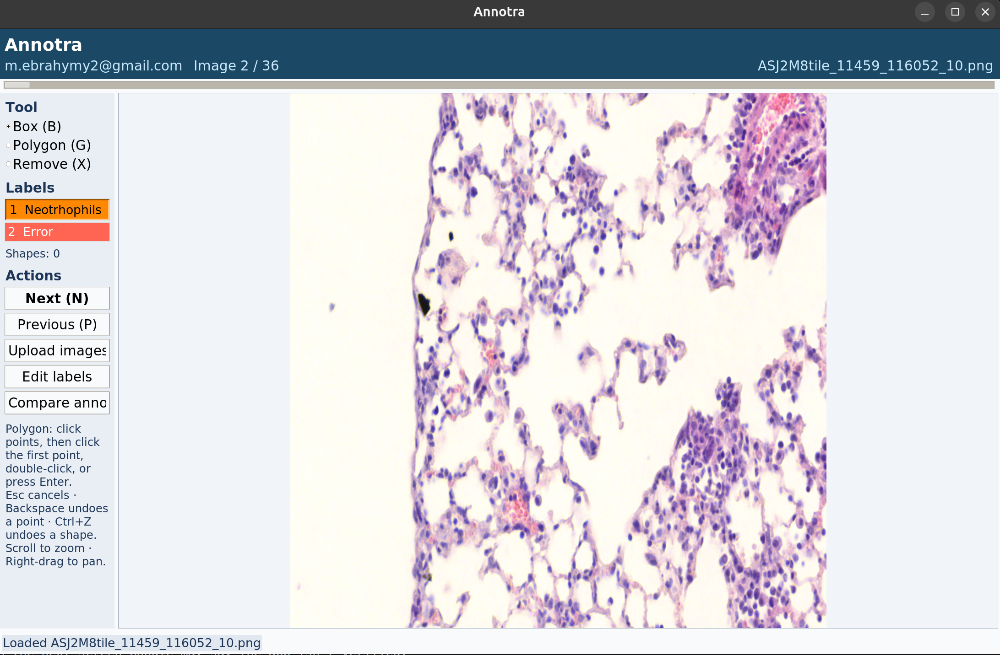
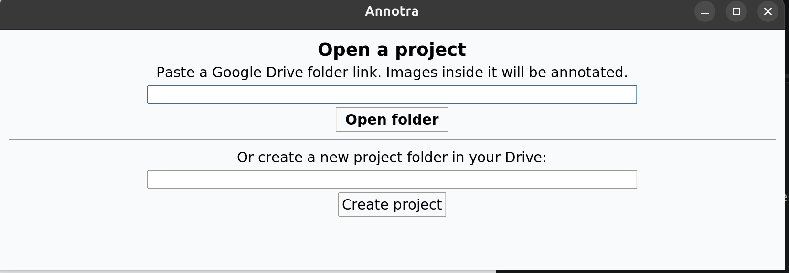

<h1 align="center">
  
</h1>

<p align="center">
  <strong>Free, serverless image annotation on your own Google Drive.</strong>
</p>

<p align="center">
  <a href="#why-use-it">Why use it</a> ·
  <a href="#run-it">Run it</a> ·
  <a href="#first-run">First run</a> ·
  <a href="#using-it">Using it</a> ·
  <a href="#files-in-drive">Files in Drive</a>
</p>

Annotra is a free, serverless app for annotating images. Your images and annotations live in your own Google Drive, so there's no server to set up, pay for, or keep running.



## Why use it

Annotating images is slow, repetitive work, and the tools often make it harder. You usually have to rent a server, install a labeling platform, and then wrangle everyone's files into one format afterwards. This app skips all that.

- **No server, no bill.** Everything goes through Google Drive, which you already have. The app runs on your own computer, and the Google setup it needs is free.
- **Bring any images.** Cells, cars, satellite photos, product shots. You make up your own labels, like "Neutrophil" or "Pothole", and pick their colors.
- **Boxes or outlines.** Drag a box, or click around something to trace its exact shape.
- **Every annotation looks the same.** Everyone's work is saved in the same simple JSON format, one file per image, so it's ready for training or analysis without cleanup.
- **Team-friendly.** Share a Drive folder and each person annotates under their own Google account. The app compares everyone's work for you and shows where people agree.
- **Pick up where you left off.** Close the app whenever you like. Next time it jumps to the first image you haven't finished.
- **Your data stays yours.** Files stay in your Drive, and your Google key stays on your computer.

## Run it

**Linux with Docker**

```bash
mkdir -p images        # images you want to upload go here, or set IMAGES_DIR
xhost +local:docker
docker compose run --rm --service-ports app
```

`--service-ports` is required, because Google sign-in returns to the app through port 8765.

**macOS with Docker**

Install XQuartz and `socat`, allow network clients in XQuartz, then keep this running in one terminal:

```bash
socat TCP-LISTEN:6000,reuseaddr,fork UNIX-CLIENT:"$DISPLAY"
```

In a second terminal:

```bash
mkdir -p images
DISPLAY=host.docker.internal:0 docker compose run --rm --service-ports app
```

**Without Docker** (needs Python with Tk)

```bash
pip install -r requirements.txt
python app.py
```

## First run

The terminal walks you through Google setup once:

1. It creates a Google Cloud project and turns on the Drive API with `gcloud`. If `gcloud` is missing or fails, it gives you links to do this in the browser.
2. You complete three short pages in Google's console. Google offers no reliable way to script these: the sign-in screen, adding test users, and creating a Desktop client.
3. You paste the downloaded client JSON.

Google then warns that the app isn't verified, because it is your own unreviewed app. Choose **Advanced** and continue.

The app stays in Google's Testing mode, so you sign in again about every 7 days, and at most 100 test users can be added. To remove the 7-day limit, add a public home page and privacy policy link on the Branding page, then click **Publish app** on the Audience page.

To join a teammate's project, ask them for their client JSON and paste it at the first prompt. They must add your email under **Test users** and share the Drive folder with you as **Editor**.

Keep the client JSON private. It is stored in `~/.annotra` with your sign-in token, or in a Docker volume, and is never built into the image.

## Using it

Create a project, or paste a link to an existing Drive folder. To get the link in Drive, right-click the folder, then choose **Share** and **Copy link**.



Images are found at any depth: PNG, JPEG, TIFF, BMP, and WebP. Saving happens when you move to another image or close the app.

| Key | Action |
|---|---|
| `B` / `G` / `X` | Box / polygon / remove tool |
| `1`-`9` | Choose a label |
| `N` / `P` | Next (marks the image done) / previous |
| `Enter` or double-click | Finish a polygon |
| `Esc` / `Backspace` | Cancel polygon / undo its last point |
| `Ctrl+Z` | Undo the last shape |
| Scroll / right-drag | Zoom / pan |

## Files in Drive

```text
Your folder/
  annotator_project.json          labels and colors
  any/images.png
  _annotations/
    you@example.com/
      <Drive file ID>.json
```

Each annotation file looks like this. Coordinates are integer pixels in the upright image, after any EXIF rotation.

```json
{
  "image_id": "1AbC",
  "image_path": "any/images.png",
  "width": 1024,
  "height": 768,
  "annotator": "you@example.com",
  "shapes": [
    {"type": "box", "label": "Car", "points": [[10, 20], [110, 90]]},
    {"type": "polygon", "label": "Road", "points": [[0, 700], [400, 500], [800, 700]]}
  ]
}
```

## Tests

```bash
python test_annotations.py
```

## Note

This project was originally developed before the rise of large language models (LLMs) and has since been enhanced and refined using Claude Code.
